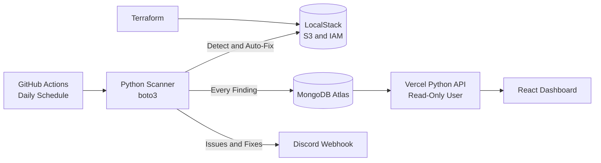

# CloudGuard — Cloud Security & Cost Governance Scanner

A scheduled cloud security and cost governance scanner that detects cloud misconfigurations, identifies storage-cost hygiene issues, automatically fixes safe problems, and flags risky configurations for human review.

Built and tested using **LocalStack** and **Terraform**.

**Live Dashboard:** https://cloudguard-peach.vercel.app

---

##  Architecture Diagram:



---

##  Detection Rules

| Rule | Resource | Severity | Action |
|---|---|---|---|
| Bucket not using KMS encryption | S3 | HIGH | **Auto-fixed** (`aws:kms`) |
| Wildcard IAM policy (`Action:*`, `Resource:*`) | IAM | HIGH | Flag only; no remediation |
| Bucket has no lifecycle policy | S3 | MEDIUM | Flagged with a cost estimate |
| Missing `Environment` tag | S3 | LOW | Flag only |
| Idle bucket (no objects) | S3 | LOW | Flag only |

### Remediation Policy

Reversible, low-risk fixes are automated. Anything involving permissions, deletion, or ownership labels requires human review.

---

##  Tech Stack:

- **Language:** Python
- **AWS SDK:** boto3
- **Testing:** pytest, moto
- **Infrastructure as Code:** Terraform
- **AWS Emulator:** LocalStack
- **Database:** MongoDB Atlas
- **Notifications:** Discord Webhooks
- **CI/CD:** GitHub Actions
- **Frontend:** React, Vite
- **Frontend Testing:** Vitest
- **Deployment:** Vercel

---

##  Project Structure:

```text
cloudguard/
├── scanner/
├── dashboard/
│   ├── api/
│   └── src/
├── infra/
├── tests/
├── .github/
│   └── workflows/
└── docs/
    └── PRD.md
```

---

##  Setup:

#### Prerequisites
- Docker
- Python 3.10+
- Terraform 1.5+
- Node.js 20+
- Free LocalStack account
- Free MongoDB Atlas cluster
- Discord Webhook URL

### 1. Clone the Repository

```powershell
git clone https://github.com/Gowthamk723/cloudguard.git
cd cloudguard
```

### 2. Set Up the Python Environment

```powershell
python -m venv venv
venv\Scripts\Activate.ps1

pip install -r scanner/requirements-dev.txt
pip install -r scanner/requirements-local.txt
```

### 3. Configure Environment Variables

Copy `.env.example` to `.env` and configure:

```env
LOCALSTACK_ENDPOINT=
MONGODB_URI=
DISCORD_WEBHOOK_URL=
```

---

##  Run the Local Environment

### 1. Start LocalStack

```powershell
localstack start -d
```

### 2. Configure Terraform

```powershell
cd infra

copy terraform.tfvars.example terraform.tfvars

terraform init
terraform apply
```

### 3. Run the Scanner

```powershell
cd ..
python scanner\scan.py
```

**Note:** Running `terraform apply` rebuilds the infrastructure and resets anything the scanner previously fixed.

---

##  Run the Dashboard

Navigate to the dashboard directory:

```powershell
cd dashboard
```

Install dependencies:

```powershell
npm install
```

Start the development server:

```powershell
npm run dev
```

---

##  Tests:

#### Unit Tests:

```powershell
pytest tests\unit --cov=scanner -v
```

#### Integration Tests:

```powershell
pytest tests\integration -v
```

#### Dashboard Tests:

```powershell
cd dashboard
npm test
```

Unit tests cover every detection rule, including negative cases and failure scenarios:

- Remediation errors
- Database write failures
- Discord notification outages

---

##  CI/CD

CloudGuard uses GitHub Actions for continuous integration and scheduled security scanning.

| Workflow | Trigger |
|---|---|
| `ci.yml` | Every push and pull request |
| `scan.yml` | Daily at 03:00 UTC or manual trigger |

### Workflow Details

- The scan job runs only if tests pass.
- Repository secrets are used for external service credentials.
- Incidents are tagged with their source: `ci` or `local`.

### Required GitHub Repository Secrets

- `MONGODB_URI`
- `DISCORD_WEBHOOK_URL`
- `LOCALSTACK_AUTH_TOKEN`

---

##  Design Decisions

#### Dependency Injection

Functions receive their AWS and database clients, making them testable with moto.

#### Log Everything, Alert Selectively

Compliant results are stored to maintain a complete audit trail. Discord notifications are sent only for problems and automated fixes.

#### Failures Never Crash a Scan

A failed remediation, database write, or notification is reported, and the scanner continues processing.

#### Only Expected Errors Mean Non-Compliant

An access error is not evidence of a misconfiguration. Such errors are logged and skipped rather than incorrectly classified.

#### Least Privilege for the Dashboard

The API uses a read-only database user. Database errors return a generic HTTP 503 response, while detailed errors are recorded in server logs.

#### Polling, Not Events

Scheduled scanning provides a verifiable approach using free tooling. CloudTrail and EventBridge are the planned path toward real-time monitoring.

#### S3 Default Encryption

AWS now encrypts new S3 buckets with SSE-S3 by default. CloudGuard identifies buckets using AWS-managed encryption keys when KMS is the configured standard.

---

##  Future Work

- [ ] Change-based alerting with first-seen and last-seen tracking.
- [ ] Dry-run mode for remediation.
- [ ] Exclusion tags.
- [ ] KMS pre-checks.
- [ ] Public-access-block remediation.
- [ ] IAM MFA checks.
- [ ] IAM access-key age checks.
- [ ] Event-driven detection using CloudTrail and EventBridge.

---